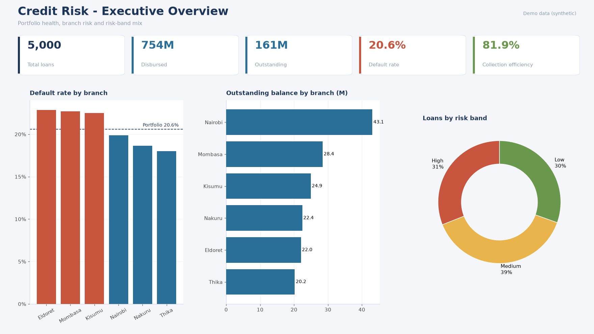
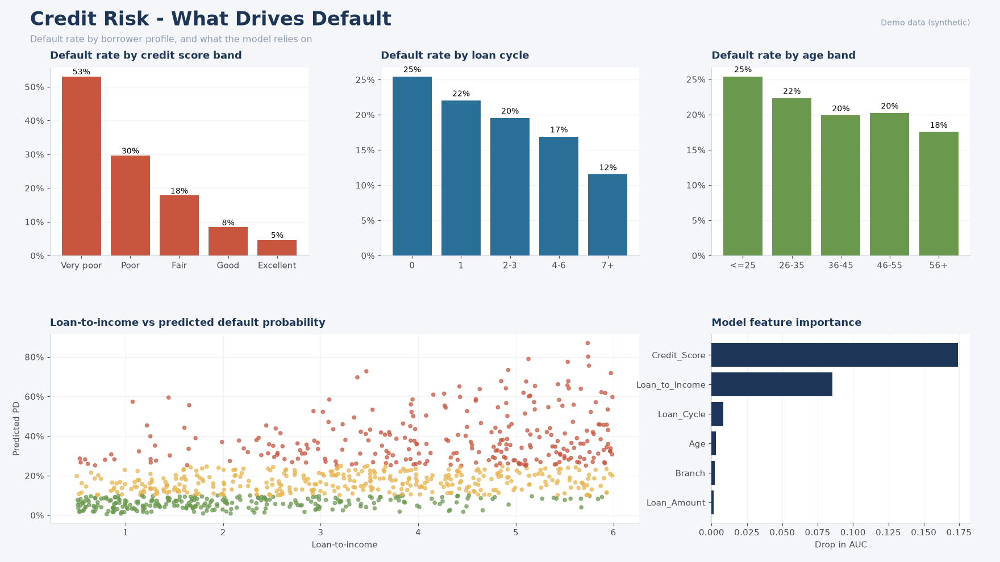
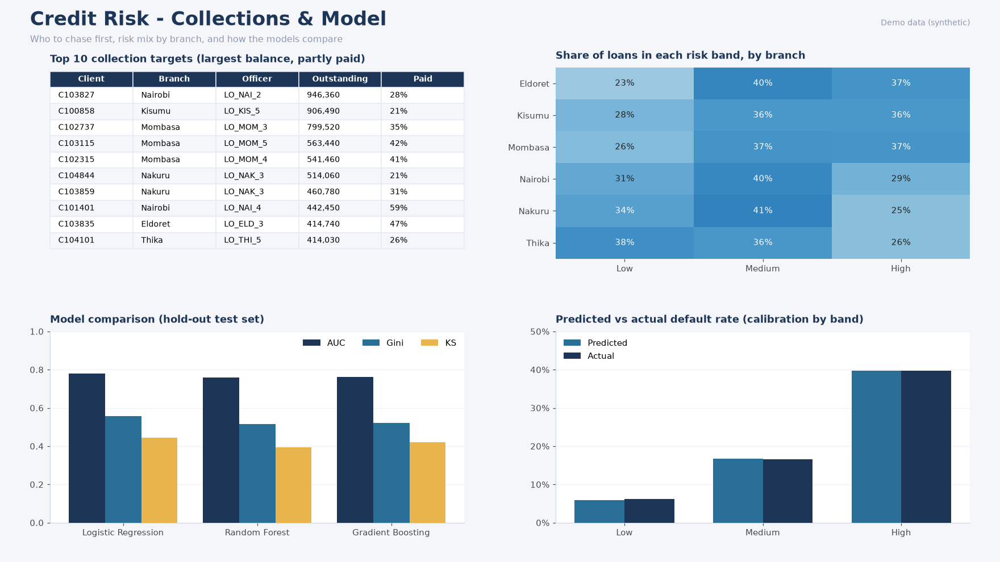

# Credit Risk Analysis & Portfolio Monitoring

**Who should we lend to, and where is the loan book going wrong?**
This project tackles both questions: a scoring model that estimates how likely an applicant is to default, and a monitoring layer that shows which branches, borrower types and accounts deserve attention first. It ends in a Power BI-ready dataset and a three-page dashboard design.

> **Heads-up on the data:** everything you see here runs on a **synthetic dataset of 5,000 loans** that I generated so the repo works straight out of the box. No real clients are involved. The patterns and numbers are for demonstration, not conclusions about any real lender. Drop your own file into `data/raw/loans.csv` and the whole pipeline re-runs on it.

---

## The dashboard





These are previews of the three pages described in [`docs/POWERBI.md`](docs/POWERBI.md). That guide has the data model, 12 DAX measures and a colour theme, so you can recreate the full interactive version in Power BI Desktop in about an hour.

---

## Why this project

A lender has two very different problems that are usually solved separately:

1. **Before the loan:** is this applicant likely to repay?
2. **After the loan:** where is the existing book deteriorating, and who should collections call first?

I wanted one project that answers both, and that is honest about the traps along the way (more on those below).

## What I found (on the demo data)

- **Credit score matters most.** Default rates fall from about 53% for "very poor" scores to about 5% for "excellent".
- **Loan size relative to income is the second biggest driver.** Borrowers stretching to repay several times their income are far riskier.
- **Experience helps.** First-time borrowers default around 25% of the time, versus about 17% for borrowers on their 4th to 6th loan.
- **Three branches sit above the 20.6% portfolio average** (Eldoret, Mombasa, Kisumu), while Thika is the safest at about 18%.
- **The risk bands are trustworthy.** Predicted default rates of 6%, 17% and 40% (Low, Medium, High) line up with the actual 6%, 17% and 40%.

## How it works

| Step | What happens |
|---|---|
| Clean | Validate columns, fix types, fill gaps, add a loan-to-income ratio |
| Monitor | Default rate, outstanding balance, collection efficiency and concentration by branch; ranked list of partly-paid accounts to chase |
| Model | Logistic Regression vs Random Forest vs Gradient Boosting, 5-fold cross-validation, untouched hold-out test set |
| Decide | A cost-based approve/decline threshold, tuned on training data only |
| Export | Scored loan-level tables for Power BI |
| Serve | A small Streamlit app to score an applicant |

### Results on the hold-out test set

| Model | CV AUC | Test AUC | Gini | KS |
|---|---|---|---|---|
| **Logistic Regression** (chosen) | 0.745 | 0.778 | 0.557 | 0.444 |
| Gradient Boosting | 0.738 | 0.761 | 0.523 | 0.420 |
| Random Forest | 0.739 | 0.758 | 0.515 | 0.395 |

At the chosen threshold the model catches about 81% of loans that would default while approving about 53% of applicants. The default rate among approved loans is about 7%, against 20.6% across the whole book.

The simplest model won, and I kept it. In lending, a model you can explain to a credit committee is worth more than an extra point of accuracy.

## Mistakes I deliberately avoided

- **Target leakage.** `Outstanding_Balance` and `Total_Paid` are only known *after* the loan is given, so they would make a model look brilliant and be useless at the point of decision. They power the monitoring side only, and a unit test makes sure they never enter the model.
- **Judging on accuracy.** With about 1 in 5 loans defaulting, "approve everyone" is already 80% accurate. I used AUC, Gini, KS, precision-recall and a calibration check instead.
- **Overconfident probabilities.** My first version used class balancing and told ordinary applicants they had a 99% chance of default. I caught it on the calibration plot and removed it, and the threshold now handles the imbalance.
- **Peeking at the test set.** The decision threshold is tuned on out-of-fold training predictions, so the test results are not flattering themselves.
- **Mismatched costs.** Approving a loan that defaults usually costs more than declining a good one. The threshold uses a 5:1 cost ratio, which is an assumption you should replace with real loss and margin numbers.

## Run it yourself

```bash
git clone https://github.com/johnthuo-analytics/Credit-risk-analysis.git
cd Credit-risk-analysis
pip install -r requirements.txt

python -m src.generate_data      # skip if you have your own data/raw/loans.csv
python -m src.eda                # EDA charts
python -m src.train              # model comparison + saved model
python -m src.export_powerbi     # tables for Power BI
python -m src.dashboard_images   # dashboard previews
python -m pytest -q              # tests
python -m streamlit run app/app.py
```

Prefer a shortcut? `make all` runs the whole pipeline.

**Windows tips**
- Use `python -m pytest` and `python -m streamlit` instead of `pytest` / `streamlit`, since pip may not add them to your PATH.
- If you see *"An Application Control policy has blocked this file"* while importing scikit-learn, Windows is blocking one of its compiled files. Try Python 3.12 in a fresh virtual environment, or run the project in Google Colab or GitHub Codespaces. The CI workflow in this repo runs everything on GitHub as well.

## Using your own data

Replace `data/raw/loans.csv` with a file that has the columns in [`data/README.md`](data/README.md), then re-run the commands above. Keep real client data out of public repos. The `.gitignore` is set up to help, but check before you push.

## Project layout

```
Credit-risk-analysis/
├── app/app.py                # Streamlit scoring app + portfolio monitor
├── data/
│   ├── raw/                  # input loans.csv
│   └── powerbi/              # scored tables for Power BI
├── docs/                     # Power BI guide, DAX, colour theme
├── images/                   # dashboard previews
├── models/                   # saved model
├── reports/                  # metrics, model comparison, EDA figures
├── src/                      # config, data, portfolio, train, evaluate, export, predict
├── tests/                    # unit tests
└── .github/workflows/ci.yml  # runs the pipeline and tests on every push
```

## Limitations and what I'd do next

- This is synthetic data, so real-world performance will differ. Treat the numbers as a demonstration of the method.
- Add SHAP explanations so each decline can be explained to an individual applicant.
- Build a Weight-of-Evidence scorecard that turns probabilities into familiar credit scores.
- Check fairness across age groups and other segments.
- Validate over time (train on older loans, test on newer ones) once loan dates are available.
- Monitor for drift after deployment and recalibrate regularly.

## License

MIT. Use it, learn from it, adapt it.
